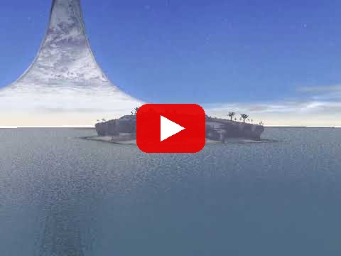
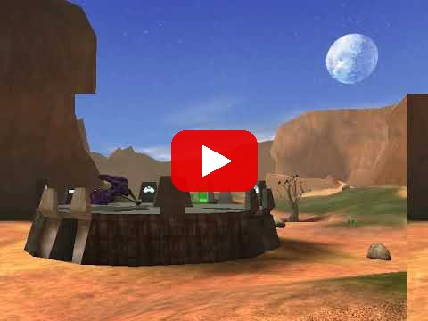
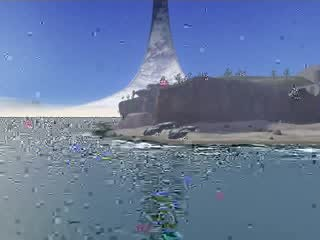
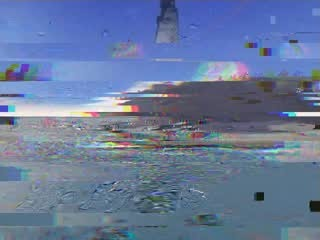
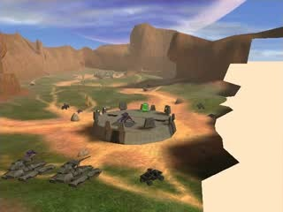
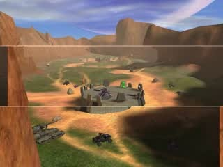
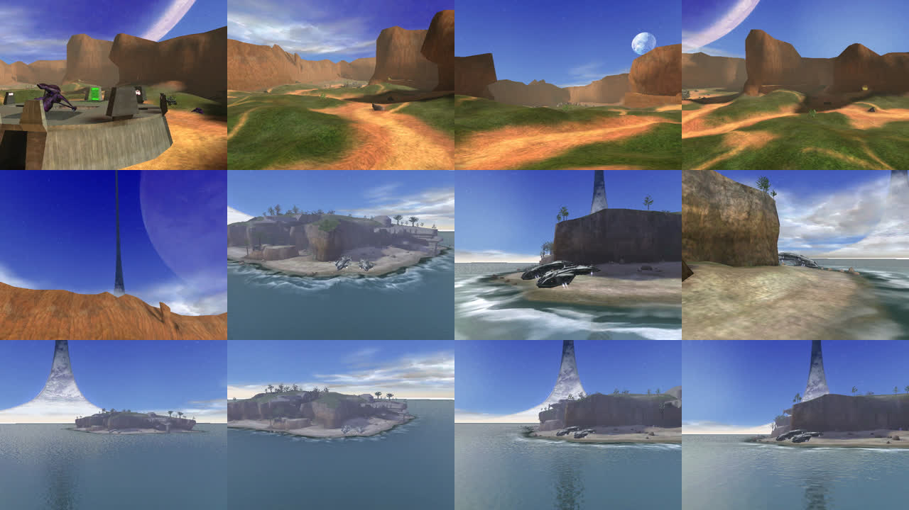
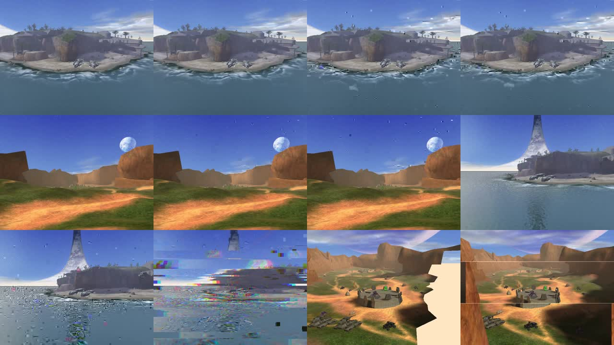

# halo-crt

Glitched-out early Halo machinima for a CRT behind a bar. This is real Halo PC
footage of Blood Gulch and the Silent Cartographer, filmed from a free camera
with no HUD, no gun and no players. It gets datamoshed and screen-torn, and
plays over a generated monk-choir/synth score that freezes and stutters along
with the picture.

## Watch

| Halo Dreams #1: Silent Cartographer | Halo Dreams #2: Blood Gulch |
|:---:|:---:|
| [](https://youtu.be/nRQmzrt82_M) | [](https://youtu.be/u0885GGNpRE) |

## Glitches

| mosh | slip + RGB split | mosh smear | tear |
|:---:|:---:|:---:|:---:|
|  |  |  |  |

**Captures** (raw):

**Glitched**:


| path | does |
|---|---|
| `capture/` | runs the free Halo PC Trial under Wine on a virtual display and films scripted camera shots |
| `capture/rig.lua` | Chimera Lua script that drives the camera along keyframed paths every frame |
| `maps/<map>/` | everything a map's hour cut depends on: `shots.py`, `score.json`, `glitch.json`, `map.json`, the approved contact sheet, and `renders/` records |
| `render.py` | films a map's shots and renders its hour cut from its folder, writing a record that `--replay` re-renders exactly |
| `maps.py` | loads and validates map folders (`./maps.py list`, `./maps.py <map> check`) |
| `glitch.py` | splices clips at the MPEG-4 bitstream level (mosh/bloom), adds tear/slip/roll, muxes the score |
| `soundtrack.py` | generative score: formant choir and chant, drones, synth arps, wind, booms, hall reverb |
| `sampler.py` | numbered, labeled reel demoing every effect once (`./sampler.py --still a b c --moving fly orbit -o sampler.mp4`) |
| `play.sh` | fullscreen, looping, self-restarting player |
| `share.sh` | uploads files to Filebin and prints download links (expire after about a week) (how renders leave a remote session) |

Full details: [docs/SETUP.md](docs/SETUP.md) (how everything works, gotchas). Shot rules: [docs/SHOT_GUIDE.md](docs/SHOT_GUIDE.md). Next steps: [docs/NEW_MAPS.md](docs/NEW_MAPS.md).

No game files are in this repo. `clips/` (your captures) is gitignored.

## 1. Capture

Uses Microsoft's free **Halo PC Trial** (2003). It includes the Blood Gulch and
Silent Cartographer maps. It runs on Linux with Wine and software GL at about
30 fps at 640x480.

```sh
# deps (Ubuntu): wine wine32:i386 xvfb xdotool p7zip-full mingw-w64 cmake ffmpeg
export HALO_DIR=~/halo-trial
7z x -o$HALO_DIR/game HaloTrialSetup.exe         # archive.org/details/halo-trial-setup
# Chimera (open source, github.com/SnowyMouse/chimera), built from tag 1.0.0r995:
#   cmake -S chimera -B build -DCMAKE_TOOLCHAIN_FILE=mingw32.cmake -DCMAKE_BUILD_TYPE=Release
#   then: mv game/Strings.dll game/strings-old.dll; cp build/strings.dll chimera/chimera.ini; cp -r chimera/fonts game/
capture/run.sh -console &                          # accept the EULA yourself on first run
# copy rig.lua to  <prefix>/drive_c/users/$USER/Documents/My Games/Halo Trial/chimera/lua/scripts/global/  (Halo CE for Custom Edition)
capture/con.sh "chimera_devmode true" "chimera_lua_reload_scripts" "map_name bloodgulch" sleep:25 "show_hud 0"
capture/k.sh BackSpace                             # free camera: no first-person view
capture/shots.sh bloodgulch                        # films into $HALO_DIR/caps/
capture/shot.sh ''                                 # release the rig
capture/con.sh "map_name b30"                      # Silent Cartographer; record the intro, then:
capture/con.sh "show_hud 0" "camera_control 1"; capture/shots.sh b30
```

Write your own shots with `capture/cap.sh name seconds '{ keys = { {t, x,y,z, lookx,looky,lookz, fov}, ... } }'`.
Keyframes use Catmull-Rom interpolation, and `ease = true` smooths the ends.
Run `capture/shot.sh '<table>'` to preview a framing as a still (`now.png`).
`debug_camera_save` writes the current camera position to `game/camera.txt`.

### Shot lists and scouting

```sh
capture/setup.sh bloodgulch                        # load + strip the map (no HUD/gun/AI/player body)
cd capture
./shotlist.py ../maps/bloodgulch/shots.py scout > s.txt    # first/last frame of every shot ...
./scout.py s.txt sheet.png                                 # ... as a numbered contact sheet
./shotlist.py ../maps/bloodgulch/shots.py run              # film every shot not already in $HALO_DIR/caps/
```

## The hour cuts

```sh
./render.py b30 bloodgulch   # about 1h of filming + 40 min of rendering per map -> cuts/*.mp4
./render.py deathisland --no-film --share   # render from existing captures, upload, keep the link
./render.py --replay maps/deathisland/renders/<stamp>.json   # re-render a past cut from its record
```

Each map's settings live in `maps/<map>/` (seed 30 for Silent Cartographer, 31
for Blood Gulch, 41 for Death Island, all with `--calm --minutes 60`), and every
render writes a record of exactly what it used. `--calm` uses long 45–90 s
shots, moshed or clean cuts only, short blooms and gentle soft tears. The score
is composed in 5-minute chunks so it never loops.

## 2. Glitch + score

```sh
pip install numpy scipy
./glitch.py clips/*.mp4 -o loop.mp4 --minutes 30 --seed 1
./glitch.py clips/*.mp4 -o heavy.mp4 --mosh 3 --tear 2.2 --bloom 0.6 --min-seg 4 --max-seg 8
```

- **mosh**: drops the keyframe of the next shot, so its motion drags the previous picture until a later keyframe heals it. Audio: a frozen grain that sinks in pitch.
- **bloom**: repeats one P-frame 8–40 times, so motion keeps smearing outward. Audio: stutter.
- **tear / slip**: a vsync tear with a lagging, horizontally slipped lower field, plus h-sync band slips with RGB split. Audio: bitcrush and stutter.
- **roll**: vertical hold loss through a black blanking bar. Audio: tape stop.

Other options: `--cards "HAPPY HOUR 5-7|LAST CALL"` adds title cards, `--mute` drops the score, and `--seed` picks a different cut and score.

## 3. Play on the CRT

```sh
./play.sh loop*.mp4
```

Output is 640x480 at 4:3, with no fake scanlines; the tube adds its own. Cheapest
player: a Raspberry Pi with composite out. On a Pi 4, set `enable_tvout=1` and
`sdtv_mode=0` (NTSC; `2` for PAL) in `/boot/firmware/config.txt`, then autostart
`play.sh`.
